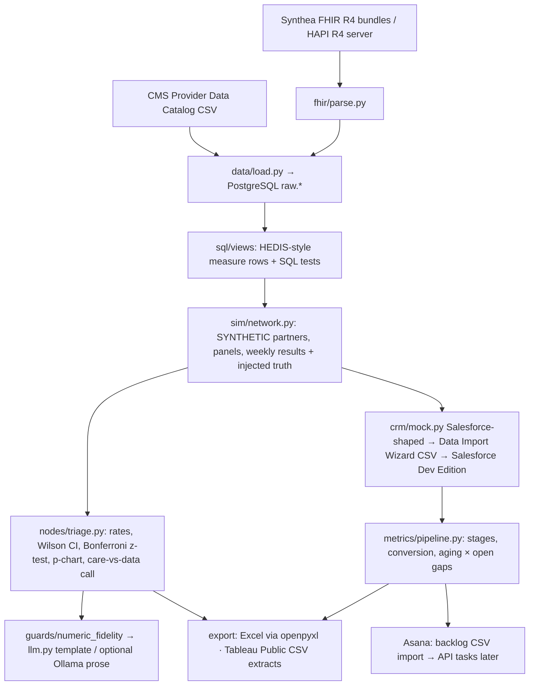

# care-ops-agent: Build Plan v2 (patient outcomes · new stack)
*Owner: Neel Srejan · v1 2026-11-03 (idea C chosen) · **v2 2026-11-03 18:40 PT: repositioned around patient outcomes; stack swapped (Neel approved 18:38 PT)** · ~3.5 weeks, 10 sessions · v1 kept as `PLAN.v1.md` · Laptop folder `Grok_Bot\Project_Agent_2` (copy when laptop is online)*

## 0. Positioning (why this is not invalid-agent again)
| | invalid-agent | care-ops-agent |
|---|---|---|
| Industry | Biotech / IVD diagnostics | Healthcare delivery (provider network / value-based care) |
| Goal | Product improvement: lower an assay's invalid rate | **Patient outcomes: close care gaps** so more patients reach HbA1c control and BP control and more women get breast cancer screening |
| Method | Fishbone → 5 Whys → 8D/CAPA (DMAIC) | **Lean / PDSA cycles** on outreach and partner support |
| Stack | Jira · Streamlit · python-pptx · dbt + DuckDB · LangGraph · Ollama | **Asana · Tableau Public · Excel (openpyxl) · PostgreSQL views · Salesforce Developer Edition · FHIR R4 (HAPI) · plain Python** |

Shared on purpose: Python, pytest, GitHub Actions, "every number computed in Python", the numeric-fidelity guard and the stats modules (Wilson CI, p-chart). Optional local LLM (Ollama) writes prose only; it is not part of the pitch.

**Honesty rules:** all partner, contract-stage, outreach and program data is SYNTHETIC and labeled. Neel has not owned partner, vendor or contract relationships, so every bullet says "simulated". Measures are "HEDIS-style" (simplified), never "HEDIS". The MBA sim is never cited; no finance/valuation claims.

## 1. Pitch
> A simulated care-gap closure program for a provider network: the agent pulls synthetic patient records over FHIR R4, finds which partner practices and clinics are falling behind on diabetes control, blood-pressure control and breast cancer screening, tells a real care gap from a data-feed problem, and points outreach to where it will help patients most. It runs the program in weekly PDSA cycles, tracks partner onboarding in Salesforce, plans the work in Asana, and reports progress in Tableau and Excel. Every rate comes from Python, never from the language model.

## 2. The story: one simulated program
"Harbor Health Plan" (synthetic) has 8 partner groups (names/locations seeded from CMS public facility data; no real relationship). Each partner panel is built from Synthea patients in each measure's denominator. 13 baseline weeks, then the program starts; each week is one PDSA cycle:
**Plan** (where to focus) → **Do** (outreach, partner support) → **Study** (care-gap rates, control charts) → **Act** (adopt / adapt / abandon) → partner + steering update.

| Week | Injection (seeded) | Agent helps the program lead… | Artifact |
|---|---|---|---|
| Baseline | — | measure each partner's HEDIS-style rates with intervals | Baseline care-gap table · Tableau extract |
| PDSA 1 | one clinic's patients lose BP control | find the clinic, separate it from noise across 96 partner/clinic/measure cells | Triage memo · outreach target list |
| PDSA 2 | one partner's HbA1c results stop arriving | label it a data issue, not missed care; hold outreach | Data-issue note · feed check task in Asana |
| PDSA 3 | a partner stalls in onboarding | join pipeline stage with open gaps; decide who can start outreach | Readiness × gaps workbook (Excel) · account plan |
| PDSA 4 | outreach script A vs B | readout of the simulated test on gaps closed | A/B readout · scaling go/no-go workbook |

## 3. Gap-to-feature map (source: SKILL_GAP_LOG.md, 79 rows as of 2026-11-03)

**Healthcare delivery/payer rows (weighted most): 14 rows / 7 companies** — Dandelion 3, Thyme Care 3, CareSource 2, Pelago 2, UCSD Health 2, Qualified Health 1, Carrum Health 1.

| Gap (log rows) | Companies | Feature that closes it | Session |
|---|---|---|---|
| AI automation of recurring partner reports (1) | Dandelion | Weekly partner status writer, per-audience, numbers from code | S6 |
| Jira / Salesforce exposure (1) | Dandelion | Asana project (CSV import → API) + Salesforce Developer Edition CRM | S1, S4 |
| Partner-contact role with eng/data teams (1, partly) | Dandelion | Simulated partner data-feed onboarding + data-quality escalations | S3, S6 |
| CRM pipeline tracking + reporting (1) | Thyme Care | Salesforce partner pipeline: stages, conversion, aging, tied to open care gaps | S4 |
| BD/account support, stakeholder maps (1, partly) | Thyme Care | Partner account plan + stakeholder map template (simulated) | S4 |
| RFP / proposal management + response library (1) | Thyme Care | RFP tracker (owners, due dates) + retrieval-backed answer library | S8 |
| MS Project / Visio EPMO toolkit (1) + large-team PM w/ budget (1, partly) | CareSource | WBS, schedule, budget burn in Excel (openpyxl); MS Project XML export; swimlane | S5, S9 |
| Clinical quality program (2, N/partly) | Pelago | HEDIS-style care-gap tracking with SPC + PDSA cycles (simplified, documented) | S3 — domain gap stays partly open |
| Clinical research ops / CTMS (2, partly) | UCSD Health | FHIR R4 data-quality checks + missing-feed detection (adjacent only) | S3 — stays mostly open |
| Roadmap + workforce/capacity mgmt (1) | Qualified Health | Roadmap + outreach capacity tracker | S1, S5 |
| Two-sided health marketplace growth ops (1, partly) | Carrum Health | Provider-supply pipeline funnel (partner → onboarded → live) | S4 |

**Cross-industry themes (keyword match over gap + JD quote columns; rows can hit >1):**

| Theme | Rows | Feature | Session |
|---|---|---|---|
| Agile / Jira / PRD / roadmap / product ownership | 15 | PRD, roadmap, Gherkin AC, 3 sprints in Asana, burndown, retro | S1, S10 |
| CRM / pipeline / account / RFP / channel | 10 | Salesforce pipeline + RFP library | S4, S8 |
| Project controls (MS Project, WBS, budget, RAID, change control, charter) | 8 | Controls pack: charter, WBS, RAID, change log, budget burn, gates (Excel), MSPDI export | S5, S9 |
| Data platform (dbt, data model, governance, catalog) | 7 | PostgreSQL raw → views, SQL tests, data dictionary + glossary (dbt deliberately not used: invalid-agent covers it) | S2 |
| API / architecture / permissions | 4 | Role-based report views (partner vs internal vs steering) + permissions spec, ADRs | S6, S10 |
| A/B / experimentation | 3 | Simulated outreach A/B test on gap closure (power calc, readout), run as a PDSA cycle | S7 |
| LLM eval methods (labeled set, failure taxonomy, regression) | 2 | Eval harness with labeled seeded scenarios, failure taxonomy, regression cases, reviewer rubric | S9 |

**Deliberately not targeted:** market research/valuation/corp-dev (not Neel's lane), contract/P&L ownership (Nava, can't be simulated honestly), Joint Commission and behavioral-health clinical domain (Pelago, Third Sector).

## 4. Architecture (plain Python orchestration)


### Reuse from invalid-agent (measured on S1–S4: 345 of 1,235 Python lines copied unchanged ≈ 28%; ≈ 40% counting adapted config.py + llm.py)
| Module | Status |
|---|---|
| `metrics/rates.py`, `metrics/spc.py`, `metrics/pareto.py`, `guards/numeric_fidelity.py` | copied unchanged |
| `config.py`, `llm.py` | adapted (slimmed; no LangChain; template-first) |
| CI workflow, LOGIC_TRACE/quiz/snapshot process | adapted (Postgres service in CI) |
| Jira adapter, Streamlit app, deck.py, LangGraph graph, dbt | **not reused** (stack swap) |

## 5. Data (verified 2026-11-03; details in DATA_LICENSES.md)
- **CMS Provider Data Catalog**, Hospital General Information (xubh-q36u, modified 2026-07-22): public domain US-government work; attribution appreciated; no implied endorsement. 5,419 facilities.
- **Synthea** (Apache-2.0; data "without restriction"): FHIR R4 1K sample (1,180 patients) used for measures.
- **HAPI FHIR R4 public test server** (https://hapi.fhir.org/baseR4): reachable (HTTP 200). Adapter is read-only by default; uploading Synthea bundles is a deliberate step.
- **Finding:** in both Synthea samples every diabetic patient's HbA1c is < 8.0% (values 2.5–7.6%) and screening is ~9%, so outcome probabilities come from scenario parameters (synthetic, labeled); Synthea supplies roster + denominators.

## 6. Stack ($0)
Python 3.11+ · pandas/numpy/scipy · psycopg 3 · PostgreSQL 17 (local; box runs it on :5433) · openpyxl · httpx · pytest · GitHub Actions (Postgres service) · Asana free Personal plan · Tableau Public · Salesforce Developer Edition · HAPI FHIR R4 · optional Ollama (prose only).

## 7. Repo structure (as built through S4)
```
care_ops_agent/
├─ PLAN.md PRD.md ROADMAP.md README.md DATA_LICENSES.md SIMULATION_DISCLAIMER.md TOOL_RESEARCH.md
├─ sql/schema/ (raw tables) · sql/views/ (measures, partner seed) · sql/tests/ (must return 0 rows)
├─ scenarios/*.yaml (SYNTHETIC, known truth)
├─ src/care_ops_agent/
│  ├─ config.py llm.py db.py run_triage.py run_pipeline.py
│  ├─ fhir/ parse.py hapi.py · data/ download.py load.py
│  ├─ metrics/ rates.py spc.py pareto.py measures.py pipeline.py
│  ├─ sim/ network.py · nodes/ triage.py · crm/ mock.py · export/ workbook.py
│  └─ guards/ numeric_fidelity.py
├─ docs/ MEASURES.md adr/ backlog/ (backlog.csv, asana_import.csv) sessions/session-N/
├─ tests/ (20 tests) · snapshots/ session-N.zip
```

## 8. Sessions (10; S1–S4 built 2026-11-03)
**Sprint 1**
- **S1 — PRD, roadmap, backlog, skeleton. DONE.** Outcome-framed PRD with Gherkin stories; ROADMAP v0; portable backlog CSV + Asana import CSV; config/llm/guard; CI. *Success:* tests green; guard rejects a planted number. ✔
- **S2 — FHIR R4 → PostgreSQL views. DONE.** Download CMS + Synthea FHIR R4; parse bundles; load `raw.*`; HEDIS-style measure views; 6 SQL tests; Python rates. *Success:* all SQL tests return 0 rows; baseline table computed in Python. ✔
- **S3 — Network sim + care-gap triage. DONE.** 8 SYNTHETIC partners × 3 clinics; weekly results; per-level Bonferroni two-proportion test + Wilson CI + p-chart; care-gap vs data-issue call; memo through the guard. *Success:* 4 dev scenarios recovered (dev set, tuned against; NOT an eval number). ✔
**Sprint 2**
- **S4 — Salesforce-shaped partner pipeline. DONE.** Account/Contact/Opportunity/stage history; conversion, aging, stalled (>14 days); readiness × open gaps; Data Import Wizard CSVs; Excel workbook; Tableau CSV; account plan + stakeholder map per partner. *Success:* hand-checked conversion and aging tests pass. ✔
- **S5 — Program controls in Excel + Asana plan. DONE.** Charter, WBS, RAID, change log, budget burn (synthetic, project-controls only) as an openpyxl workbook. Asana tasks go through the offline client and a CSV import. The live API client exists and is not called.
- **S6 — Weekly PDSA loop + per-audience updates. DONE.** PDSA cycle log (plan/do/study/act per week); partner-safe vs internal vs steering updates with a role filter; permissions spec.
- **S7 — Outreach A/B as a PDSA cycle. DONE.** Power calc, randomization, two-proportion readout on gaps closed; recovers the seeded effect and reports null on an equal-rate repeat.
**Sprint 3**
- **S8 — RFP response library. DONE.** 40 synthetic payer RFP questions; answers cite library entries or are flagged.
- **S9 — Eval harness + MS Project XML. DONE.** 20 held-out seeded scenarios; failure taxonomy; MS Project XML export of the WBS.
- **S10 — Tableau-ready extracts + scaling go/no-go workbook. DONE.** CSV extracts, a dashboard spec, and a local preview. Publishing to Tableau Public is a manual step. README and resume bullets are filled from the eval report.

## 9. Eval design
Seeded scenarios (≈20, 20% held out; the 4 S3 dev scenarios are excluded from scoring): one-clinic care gap ×3, partner-wide gap ×3, missing-feed data issue ×3, data issue on a different measure ×2, onboarding stall ×2, mixed causes ×2, no-signal ×3, near-threshold ×2.
Metrics: right partner/clinic/measure (top-1/top-3); care-vs-data call accuracy; false alarms on no-signal; numeric fidelity (target 100%); partner-view leaks (target 0); A/B effect recovery; Neel's 4-point rubric on ~30 updates with a 10-item re-grade for consistency.

## 10. Epics (portable; import to Asana)
COA-E1 Product framing · E2 Data layer (FHIR → PostgreSQL views) · E3 Network sim + care-gap triage · E4 Partner pipeline (Salesforce) · E5 Program controls (Lean/PDSA) · E6 Weekly partner updates · E7 Outreach experiment · E8 RFP library · E9 Evals · E10 Tableau dashboard + scaling go/no-go.

## 11. Résumé bullets

Filled from the eval report. See `RESUME_BULLETS.md`. Do not edit those numbers by hand. The draft that used to live here is retired.

## 12. Interview story (~2 min)
- **Situation:** Healthcare delivery roles kept asking for people who can move outcomes across a network: care gaps, partner readiness, data feeds, reporting.
- **Task:** Show I can run a care-gap program end to end and measure whether my tool points effort at the right patients.
- **Action:** I built a simulated network of 8 partner groups from public CMS data and Synthea synthetic patients over FHIR R4, wrote three HEDIS-style measures as PostgreSQL views, and kept every rate in Python. I ran weekly PDSA cycles: a clinic whose patients lost BP control, a partner whose HbA1c results stopped arriving (a data problem, not a care problem), a stalled onboarding, and an outreach A/B test. Partners lived in Salesforce, the plan in Asana, results in Tableau and Excel.
- **Result:** On the held-out set, triage named the right practice and measure in 11 of 11 single-cause scenarios, with 1 false alarm on 5 quiet scenarios, so the scaling rule says no-go. The seeded outreach effect was recovered in 20 of 20 runs, and the equal-rate version stayed quiet in 28 of 30. One thing I learned early: the public Synthea sample shows 100% diabetes control, so I couldn't trust it for outcomes. I used it for patient rosters and stated where the outcome rates came from. It's a simulation, and I say so.

## 13. Risks
- Synthea outcome realism (found in S2) → roster/denominators only; outcomes from labeled scenario parameters; optional fresh Synthea run later (needs Java).
- Multiple comparisons across 96 cells → per-level Bonferroni; clinic-level power needs ~300 patients per partner per measure (synthetic panel size chosen for this; documented).
- Overfitting to dev scenarios → eval uses held-out scenarios only.
- Free tiers: Asana Personal has no Timeline/dependencies (Gantt stays in Excel/MS Project XML); Salesforce Dev Edition needs regular logins; Tableau Public dashboards are public (fine: synthetic data). FHIR bundles stay local; upload to a public server is blocked.
- Optics: "SIMULATION", "SYNTHETIC", "HEDIS-style", "simulated" everywhere.

## 14. Sequencing
invalid-agent core S1–S9 is built (snapshots 1–9); its add-ons S10–S12 are not. care-ops-agent S1–S4 were built 2026-11-03. S5–S10 are in this repo with offline stand-ins. Live Asana, Salesforce, and Tableau Public still wait on accounts.

## 15. Inputs needed from Neel
1. Free accounts (Neel signs up; the agent never creates accounts): Asana Personal https://asana.com/pricing · Salesforce Developer Edition https://developer.salesforce.com/free-trials · Tableau Public https://public.tableau.com/app/discover (Desktop Public Edition).
2. ~20 min to sanity-check the 4 S3 scenarios and baseline rates (scenarios/*.yaml).
3. FHIR stays local. Do not upload bundles to a public test server.
