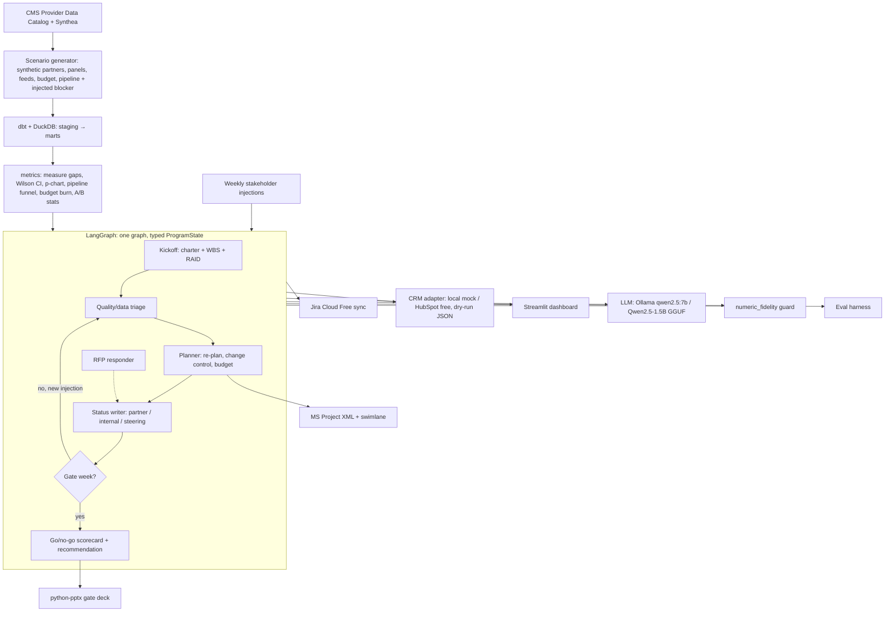

# care-ops-agent: Build Plan v1 (simulation-first)
*Owner: Neel Srejan · v1 2026-11-03 (Neel chose idea C on 2026-11-03) · Target: **~3.5 weeks, 10 sessions** · Sister project to `invalid-agent` (`/workspace/project-agent/PLAN.md`) · Local folder: `Grok_Bot\Project_Agent_2` (suggested, see §13)*

**Locked decisions (carried from invalid-agent):** public repo on Neel's personal GitHub · **free tools only, $0 for Neel and every visitor** · local dev with Ollama `qwen2.5:7b`; hosted demo with Qwen2.5-1.5B-Instruct GGUF (llama.cpp) on **Streamlit Community Cloud** + Codespaces backup · each session = Cursor cloud agent PR → narrated video walkthrough → Neel runs the demo → quiz → merge (Dr Eggbot gates merges) · **Jira Cloud Free** is the tracker integration · CRM is a **local mock with an optional HubSpot free adapter** (dry-run JSON by default) · all data is **public seed data plus synthetic simulation data, labeled as a simulation**.

**Deterministic-numbers rule (unchanged):** every number (rates, measure gaps, control limits, budget burn, pipeline counts, conversion, CIs, test results) is computed in Python/SQL. The LLM only writes narrative, ranks options with stated evidence, and drafts communications. The numeric-fidelity guard rejects any narrative number that doesn't match a computed value.

**Honesty rules:** Neel has **not** owned vendor, partner or contract relationships. Every artifact and bullet says "simulated". No claim of real partners, payers, patients or PHI. The MBA sim is never cited; no finance/valuation claims (budget burn is a project-controls artifact, not finance experience).

**Out of scope:** multi-agent crews, real Salesforce/HubSpot customer data, real PHI, RAG for its own sake, fine-tuning, HEDIS-certified measure logic (we use simplified, documented measure definitions), clinical decision-making.

---

## 1. Pitch

> An AI agent that runs a simulated 4-week provider-network onboarding program for a payer/value-based-care company: it tracks a partner pipeline in a CRM, keeps the onboarding plan (charter, WBS, RAID, budget burn, go/no-go gates) current, finds quality-measure gaps with control charts, drafts weekly partner status reports per audience, and answers RFP questions from a reusable library. Every number comes from code; the LLM writes the words.

Resume framing (same as invalid-agent): "my daily program-ops workflow in a healthcare network, with an AI agent I built as my tool." Shows the same PM method carried into a second industry (payer/provider ops).

## 2. The story: one simulated program, week by week

A simulated payer ("Harbor Health Plan", synthetic) is onboarding **8 synthetic provider groups** (built on real CMS facility/clinician records as seeds) into a value-based network. Each week runs the invalid-agent loop: **plan → execute → communicate → stakeholder feedback → re-plan → gate decision**.

| Sim week | Stakeholder injection | Neel uses the agent to… | Artifact |
|---|---|---|---|
| 0 Kickoff | Network lead: "8 groups, go-live in 4 weeks"; payer RFP lands | build charter, WBS, RAID v1, budget baseline; load pipeline; triage RFP questions | Charter · WBS · RAID v1 · Jira epic/stories · CRM pipeline v1 · RFP tracker |
| 1 | Data/IT: 2 groups' eligibility files fail validation | quantify file-quality defects, re-plan, raise risk, change request | Data-quality summary · change-control log #1 · status #1 (partner + internal) |
| 2 | Quality lead: one group's diabetes-control measure gap is out of control | p-chart on measure gap, segment by clinic/panel, outreach plan | Quality-gap report · p-chart · outreach A/B design |
| 3 | Finance PMO: "burn is ahead of plan"; one partner stalls in contracting stage (simulated) | budget burn vs plan (EV-lite), re-sequence WBS, partner escalation note | Budget burn chart · RAID v3 · status #3 · gate pre-read |
| 4 Gate | Steering committee go/no-go | gate scorecard per partner, recommendation, outreach test readout | Go/no-go deck (.pptx) · MS Project XML · retro |

**Seeded scenarios** vary the true blocker (data-feed defects, measure-gap driver = one clinic vs whole panel vs data artifact, budget overrun cause, stalled pipeline stage, resource conflict, no real problem / red herring) so the agent is scored against a known answer.

## 3. Gap-to-feature map (source: SKILL_GAP_LOG.md, 79 rows as of 2026-11-03)

**Healthcare delivery/payer rows (weighted most): 14 rows / 7 companies** — Dandelion 3, Thyme Care 3, CareSource 2, Pelago 2, UCSD Health 2, Qualified Health 1, Carrum Health 1.

| Gap (log rows) | Companies | Feature that closes it | Session |
|---|---|---|---|
| AI automation of recurring partner reports (1) | Dandelion | Weekly partner status writer, per-audience, numbers from code | S6 |
| Jira / Salesforce exposure (1) | Dandelion | Jira Free sync + CRM adapter (mock, optional HubSpot free) | S1, S4 |
| Partner-contact role with eng/data teams (1, partly) | Dandelion | Simulated partner data-feed onboarding + data-quality escalations | S3, S6 |
| CRM pipeline tracking + reporting (1) | Thyme Care | Partner pipeline stages, conversion, aging, pipeline dashboard | S4 |
| BD/account support, stakeholder maps (1, partly) | Thyme Care | Partner account plan + stakeholder map template (simulated) | S4 |
| RFP / proposal management + response library (1) | Thyme Care | RFP tracker (owners, due dates) + retrieval-backed answer library | S8 |
| MS Project / Visio EPMO toolkit (1) + large-team PM w/ budget (1, partly) | CareSource | WBS, resource-loaded schedule, MS Project XML export, swimlane; budget burn | S5, S9 |
| Clinical quality program (2, N/partly) | Pelago | Quality-measure gap tracking with SPC (simplified measures, documented) | S3 — domain gap stays partly open |
| Clinical research ops / CTMS (2, partly) | UCSD Health | Data-quality checks + query log on Synthea records (adjacent only) | S3 — stays mostly open |
| Roadmap + workforce/capacity mgmt (1) | Qualified Health | Product roadmap for the agent + resource/capacity tracker in WBS | S1, S5 |
| Two-sided health marketplace growth ops (1, partly) | Carrum Health | Provider-supply pipeline funnel (partner → onboarded → live) | S4 |

**Cross-industry themes (keyword match over gap + JD quote columns; rows can hit >1):**

| Theme | Rows | Feature | Session |
|---|---|---|---|
| Agile / Jira / PRD / roadmap / product ownership | 15 | PRD, roadmap, Gherkin AC, 3 Jira sprints, burndown, retro | S1, S10 |
| CRM / pipeline / account / RFP / channel | 10 | CRM pipeline + RFP library | S4, S8 |
| Project controls (MS Project, WBS, budget, RAID, change control, charter) | 8 | Controls pack: charter, WBS, RAID, change log, budget burn, gates, MSPDI export | S5, S9 |
| Data platform (dbt, data model, governance, catalog) | 7 | dbt + DuckDB staging → marts, dbt tests, glossary + data dictionary | S2 |
| API / architecture / permissions | 4 | Role-based report views (partner vs internal vs steering) + permissions spec, ADRs | S6, S10 |
| A/B / experimentation | 3 | Simulated outreach A/B test (power calc, readout) on gap closure | S7 |
| LLM eval methods (labeled set, failure taxonomy, regression) | 2 | Eval harness with labeled seeded scenarios, failure taxonomy, regression cases, reviewer rubric | S9 |

**Deliberately not targeted:** market research/valuation/corp-dev (not Neel's lane), contract/P&L ownership (Nava, can't be simulated honestly), Joint Commission and behavioral-health clinical domain (Pelago, Third Sector).

## 4. Architecture



### Reuse from invalid-agent (estimated ~40% of LOC reused or adapted)

| invalid-agent module | Reuse in care-ops-agent | How |
|---|---|---|
| `config.py`, `pyproject.toml`, CI workflow, `.env.example` | as-is | rename package |
| `llm.py` (ollama / llamacpp / rules-only) | as-is | — |
| `guards/numeric_fidelity.py` | as-is | add currency/percent formats |
| `metrics/rates.py` (Wilson CI, chi-square strata), `metrics/spc.py` (p-chart, Western Electric) | as-is | applied to measure-gap and feed-defect rates |
| `metrics/pareto.py` | as-is | feed-defect codes, RFP question categories |
| `case/state.py` + `schemas.py` patterns | adapted | `ProgramState`, `Charter`, `WBSItem`, `RAIDItem`, `ChangeRequest`, `GateScore`, `PartnerStatus` |
| `nodes/status.py` (per-audience RAG + role filter) | adapted | partner / internal / steering views |
| `nodes/planner.py`, `artifacts/gantt.py`, `artifacts/risk_register.py` | adapted | RAID adds Assumptions/Issues/Dependencies |
| `integrations/jira.py` (dry-run JSON) | as-is | new project key |
| `artifacts/deck.py` (python-pptx) | adapted | gate deck template |
| `app/streamlit_app.py` layout (scenario picker, week stepper, rules-only mode) | adapted | new tabs |
| `evals/run_eval.py` harness | adapted | new metrics |
| invalid-agent S10–S12 add-ons (MSPDI export, A/B readout, dbt layer, burndown export) | reused if built first | see §12 |
| `walkthrough/render.py`, LOGIC_TRACE/snapshot process | as-is | — |

New code: CMS/Synthea loaders, network sim generator, measure-gap logic, CRM adapter, pipeline metrics, budget burn, RFP library, gate scorecard.

## 5. Data sources (verified 2026-11-03)

| Source | What it gives | Link | License | Notes |
|---|---|---|---|---|
| CMS Provider Data Catalog (PDC) | Real facility/clinician directories and public quality measures (Hospital, Doctors & Clinicians, etc.) used as seeds for partner profiles and measure baselines | https://data.cms.gov/provider-data/ · API: `https://data.cms.gov/provider-data/api/1/datastore/query/{datasetID}/0` (no key) · catalog: https://data.cms.gov/data.json | **US-government work, public domain**; attribution to CMS appreciated; no implied government endorsement (42 U.S.C. 1320b-10). CMS notes some datasets may carry their own terms, so check each dataset page in S2. | Use the data.json catalog for download URLs rather than hard-coding them (CMS guidance). Pick 2–3 datasets in S2 (e.g., Doctors & Clinicians national file + one quality-measure file). |
| Synthea (MITRE) synthetic patients | Synthetic patients, encounters, conditions, observations (e.g., HbA1c, BP) → panel-level measure gaps | https://github.com/synthetichealth/synthea · prebuilt samples at https://synthea.mitre.org/downloads | **Apache-2.0** (verified from repo LICENSE) | Fully synthetic, no PHI. Generate ~5–20K patients for one state locally (Java) or use prebuilt CSV samples. Keep the LICENSE/NOTICE. |
| Synthetic (ours) | Payer, partner groups, contracts stage, eligibility-feed defects, budget, resources, outreach, RFP questions | — | Ours, labeled "SYNTHETIC — SIMULATION" | Generated from seeded YAML scenarios. |

**Labels:** the golden set is constructed (known injected blocker per scenario) plus a hand-labeled set of ~30 status-report and RFP answers Neel grades with a rubric (see §8).

## 6. Tech stack ($0)

Same as invalid-agent §5, plus: **DuckDB + dbt-core + dbt-duckdb** (data layer; Neel writes the SQL queries the work needs) · **HubSpot free CRM** (optional adapter; mock is default so demos need no account) · **MS Project XML (MSPDI)** export that opens in ProjectLibre/MS Project · Mermaid swimlane · MiniLM embeddings for RFP answer retrieval (only where retrieval is the feature) · scipy/statsmodels for power calc.

## 7. Repo structure

```
care-ops-agent/
├─ README.md, PRD.md, ROADMAP.md, DATA_LICENSES.md, SIMULATION_DISCLAIMER.md
├─ scenarios/                  # YAML: seed, true blocker, weekly injections
├─ data/ (gitignored raw; READMEs kept)
├─ dbt/ models/staging, models/marts, tests, docs   # glossary + data dictionary
├─ src/care_ops_agent/
│  ├─ sim/ cms_loader.py, synthea_loader.py, generate.py
│  ├─ metrics/ rates.py, spc.py, pareto.py (reused), measures.py, pipeline.py, budget.py, abtest.py
│  ├─ program/ state.py, schemas.py
│  ├─ nodes/ kickoff.py, triage.py, planner.py, status.py, rfp.py, gate.py
│  ├─ guards/ numeric_fidelity.py
│  ├─ artifacts/ charter.py, wbs.py, raid.py, change_log.py, mspdi.py, swimlane.py, deck.py
│  ├─ integrations/ jira.py, crm_mock.py, hubspot.py
│  ├─ llm.py, graph.py
├─ app/ streamlit_app.py
├─ evals/ scenarios/, labeled/, run_eval.py, reports/
├─ docs/ adr/, sessions/session-N/LOGIC_TRACE.md
└─ tests/
```

## 8. Build sessions (10 sessions, ~3.5 weeks, ~1,900 LOC + SQL/docs)

Same loop as invalid-agent: PR → narrated video per new file → Neel runs demo → 3–5 question quiz → Dr Eggbot gate → merge → tag `session-N` → snapshot + `LOGIC_TRACE.md`. The build runs as **3 Jira sprints** (S1–S3, S4–S7, S8–S10). ADRs written alongside each session.

### Sprint 1: framing, data, quality triage

**S1 — PRD, roadmap, backlog, skeleton (~100 LOC + docs; ~70% reused)**
- Deliverable: `PRD.md` (problem, users: network ops PM / quality lead / partner; user stories with Gherkin AC; success metrics; non-goals), `ROADMAP.md` v0 (Now/Next/Later), Jira project with 3 sprints and epics (§10), repo skeleton copied from invalid-agent (config, llm.py, guard, CI), `SIMULATION_DISCLAIMER.md`, `DATA_LICENSES.md`.
- Success: CI green on 3.11/3.12; Jira Sprint 1 has ≥8 stories with AC; PRD reviewed by Neel.
- Gaps: agile/PRD/roadmap (15), Jira (Dandelion, Procede), Qualified Health roadmap.

**S2 — Data layer: CMS + Synthea → dbt/DuckDB (~150 LOC Python + ~200 lines SQL/YAML)**
- Deliverable: loaders pull 2–3 PDC datasets via the catalog and a Synthea sample; dbt staging → marts (`dim_partner`, `dim_clinic`, `fct_patient_measure`, `fct_feed_file`); dbt tests (not_null, unique, accepted_values, relationships); dbt docs + business glossary (measure, numerator, denominator, gap, eligibility file).
- Success: `dbt build` passes all tests; row counts printed and recorded; licenses + attribution in `DATA_LICENSES.md`.
- Gaps: dbt/data model/governance (7; Toast, Synctera).

**S3 — Network sim generator + quality/data triage (~300 LOC)**
- Deliverable: `generate.py` makes 8 synthetic partner groups seeded from CMS records with an injected blocker per scenario; `measures.py` (2–3 simplified, documented measures, e.g., diabetes HbA1c control, BP control, from Synthea observations); feed-defect rates; reused Wilson CI + p-chart; `triage.py` node writes a Week-0/1 quality + data-quality memo with the numeric-fidelity guard.
- Success: on `scenarios/feed_defects.yaml` the memo names the right partners; guard rejects a planted wrong number; control limits match hand calcs in tests.
- Gaps: Dandelion partner reporting / data teams, Pelago quality (partly), UCSD data quality (adjacent).

### Sprint 2: pipeline, controls, weekly loop, experiment

**S4 — CRM partner pipeline (~220 LOC)**
- Deliverable: `crm_mock.py` (SQLite/JSON: companies, contacts, deals, stages: Prospect → Qualified → Contracting (simulated) → Data onboarding → Live); optional `hubspot.py` adapter to HubSpot free CRM (dry-run default); `pipeline.py` metrics (stage conversion, aging, stuck deals); partner account plan + stakeholder map template.
- Success: pipeline funnel and aging table computed in code; adapter tests run against a mocked API; demo works with no HubSpot account.
- Gaps: CRM/pipeline (10; Thyme Care, Egan-Jones, ServiceTitan), Carrum supply funnel, Dandelion Salesforce (adjacent).

**S5 — Project-controls pack (~260 LOC)**
- Deliverable: `charter.py`, `wbs.py` (resource-loaded WBS, dependencies, critical path), `raid.py` (Risks/Assumptions/Issues/Dependencies with likelihood × impact), `budget.py` (synthetic baseline vs actual burn, variance, simple planned-vs-earned view), Gantt (reused), Jira sync of WBS → stories.
- Success: critical path matches a hand-checked example; budget variance tests pass; Jira dry-run JSON shows the epic tree.
- Gaps: project controls (8; CareSource, Algolia, Syner-G, Natera budget), Qualified Health capacity.

**S6 — Weekly loop: injections, change control, per-audience status (~280 LOC)**
- Deliverable: weekly injections in scenario YAML; loop: injection → re-plan → change request in `change_log.py` → RAID update → `status.py` drafts partner-safe, internal and steering versions (role-based field filter + permissions spec in `docs/PERMISSIONS.md`) → Jira status sync.
- Success: step weeks 1–3 on 2 scenarios; diffs in WBS/RAID between weeks; every status passes the fidelity guard; partner view never shows internal-only fields (test).
- Gaps: Dandelion automated partner reports, API/permissions (4), stakeholder mgmt.

**S7 — Outreach A/B test (simulated) (~150 LOC)**
- Deliverable: `abtest.py`: power/sample-size calc, randomization of synthetic patients with open gaps to outreach script A vs B, simulated response with a known true effect per scenario, two-proportion test + CI, ramp plan and readout memo; the agent writes the narrative, numbers come from code.
- Success: the test recovers the seeded effect within its CI in the positive scenario and reports "no detectable difference" in the null scenario.
- Gaps: A/B (3; Macy's, OnePay, Zumper).

### Sprint 3: RFP, evals, dashboard, close-out

**S8 — RFP response library (~200 LOC)**
- Deliverable: synthetic payer RFP (~40 questions, labeled synthetic); `rfp.py`: tracker (owner, due date, status, Pareto of question categories) + answer library (~30 Neel-reviewed answers drawn from project docs) with embedding retrieval; drafts answers with citations to library entries; flags unanswerable questions instead of inventing.
- Success: every drafted answer cites a library entry or is flagged "needs SME"; tracker shows status by owner.
- Gaps: RFP (Thyme Care), proposals (Egan-Jones).

**S9 — Eval harness + MS Project export (~260 LOC + ~20 scenario YAMLs)**
- Deliverable: 20 seeded scenarios (§9) with 20% held out; `run_eval.py` scores blocker hit rate, numeric fidelity, citation validity, permission leaks, RFP grounding, latency; 7B vs 1.5B comparison; failure taxonomy + regression cases; reviewer rubric for Neel's labels; `mspdi.py` MS Project XML export + Mermaid swimlane.
- Success: report written to `evals/reports/<date>.md` with n and failure cases; 5-scenario smoke eval runs in CI; exported XML opens in ProjectLibre.
- Gaps: LLM eval methods (Toast IQ), MS Project/Visio (CareSource, Qualcomm).

**S10 — Dashboard, gate deck, README, résumé (~250 LOC)**
- Deliverable: Streamlit app (scenario picker, week stepper, pipeline funnel, measure-gap p-chart, budget burn, RAID, status drafts, rules-only mode) deployed to Streamlit Community Cloud with simulation banner; `gate.py` scorecard + python-pptx go/no-go deck; ROADMAP v1 + iteration log; Jira burndown export + retro notes; README with eval table and limits; résumé bullets filled from the eval report.
- Success: public URL works from a phone; deck opens in PowerPoint/Google Slides; Neel presents the gate decision unaided in 2 minutes.
- Gaps: exec communication, product ownership, Jira depth.

**Stretch rule:** S5 and S9 are heaviest; if either slips, split it (→ 11 sessions, ~4 weeks). Stretch only if a quiz isn't passed, not to add features.

## 9. Eval design

**Seeded scenarios (20; 4 held out):**

| Type | Count | Injected truth the agent must find |
|---|---|---|
| Eligibility-feed defects at specific partners | 3 | which partners, which defect code |
| Measure gap driven by one clinic | 3 | the clinic (SPC signal) |
| Measure gap that is a data artifact (missing labs feed) | 2 | "data issue, not care issue" |
| Budget overrun cause (scope add vs rate vs schedule slip) | 3 | the driver, tied to a change request |
| Pipeline stall at a stage | 2 | stage + partner |
| Resource conflict on critical path | 2 | task + slip in days |
| Red herring / no real problem | 3 | "no action / stay green" |
| Mixed (two causes) | 2 | both in top-3 |

**Metrics:** top-1 / top-3 blocker hit rate; gate recommendation correctness (go / conditional go / no-go vs constructed answer); numeric fidelity (target 100%; any miss is a bug); citation validity; permission-leak rate in partner views (target 0); RFP grounding rate (answers citing a library entry or correctly flagged); A/B recovery (seeded effect inside CI); latency per week-step; 7B vs 1.5B.
**Human labels:** Neel grades ~30 status reports and RFP answers on a 4-point rubric (accurate, complete, audience-appropriate, actionable); a second pass on 10 of them checks his own consistency (reviewer calibration).
**Reporting:** n, per-scenario table, failure taxonomy, and regression list in every report. Résumé numbers come only from these reports.

## 10. Jira epics (project key `COA`)

1. COA-E1 Product framing (PRD, roadmap, permissions spec, ADRs)
2. COA-E2 Data layer (CMS + Synthea loaders, dbt/DuckDB, tests, glossary)
3. COA-E3 Simulation + quality triage (generator, measures, SPC, memo)
4. COA-E4 Partner pipeline / CRM (mock + HubSpot adapter, funnel, account plan)
5. COA-E5 Project controls (charter, WBS, RAID, budget burn, change control, MS Project export)
6. COA-E6 Weekly status automation (injections, per-audience reports, Jira sync)
7. COA-E7 Outreach experiment (power calc, readout)
8. COA-E8 RFP response library
9. COA-E9 Evals (scenarios, harness, labels, model comparison)
10. COA-E10 Dashboard, gate deck, release (Streamlit deploy, README, burndown, retro)

## 11. Draft résumé bullets (fill [__] only from real eval output; no numbers until measured)

- Built a portfolio AI agent that runs a simulated 4-week provider-network onboarding program: charter, resource-loaded WBS, RAID and change-control logs, budget burn and weekly go/no-go gates, with every number computed in code; correct gate call on [__] of [__] seeded scenarios.
- Automated simulated weekly partner status reports for partner, internal and steering audiences with role-based views; [__]% numeric fidelity and [__] permission leaks across [__] evaluated reports.
- Tracked a simulated partner pipeline in a CRM (stage conversion, aging, stalled deals) and built an RFP tracker and reusable answer library; [__]% of drafted answers grounded in library sources.
- Found quality-measure gaps on CMS public data and Synthea synthetic patients with p-charts, and designed a simulated outreach A/B test (power calculation, readout); wrote the SQL queries the work needs in a dbt/DuckDB layer with tests and a data glossary.
- Built an evaluation set of [__] labeled scenarios with a failure taxonomy and regression cases; [__]% top-1 / [__]% top-3 blocker hit rate; compared a 7B and a 1.5B local model.
- Ran the build as 3 Jira sprints with a PRD, roadmap, Gherkin acceptance criteria, burndown and retros.

## 12. Interview story (STAR, ~2 min)

- **Situation:** I kept seeing healthcare ops roles (payer growth, network ops, program management) ask for partner reporting automation, CRM pipelines, RFPs and formal project controls, and I wanted proof I could run that work, not just describe it.
- **Task:** build a simulated network-onboarding program where I'm the program manager and an AI agent is my tool, and score it against known answers.
- **Action:** I seeded 8 synthetic provider groups from CMS public data and Synthea synthetic patients, built the data layer in dbt/DuckDB, kept every number in code with a guard that blocks the LLM from inventing figures, and stepped the program week by week: data-feed defects, a measure gap that turned out to be one clinic, a budget variance tied to a change request, and a go/no-go gate. I ran the build itself as Jira sprints and built an eval set to measure the agent.
- **Result:** [__ from eval report: gate accuracy, fidelity, hit rate], plus a failure I found and fixed: [__ from failure taxonomy]. Same method as my first project (field-quality investigation), now in a second industry. It's a simulation; I haven't owned real partner contracts, and I say so.

## 13. Risks

- **Domain credibility:** measure logic is simplified (not HEDIS-certified). Mitigation: document definitions, cite CMS/Synthea, label as simulation.
- **Overclaiming relationships:** Neel hasn't owned partner/vendor/contract work. Mitigation: "simulated" in every bullet, README, app banner and deck.
- **Scope creep (heaviest of the three ideas):** 10 sessions with new domain logic. Mitigation: cap measures at 2–3, partners at 8, RFP at ~40 questions; split S5/S9 rather than add features.
- **Synthea setup:** requires Java to generate locally. Mitigation: start from prebuilt sample CSVs.
- **CMS dataset terms/URLs change:** use the data.json catalog, pin a snapshot date, check each dataset page for extra terms.
- **HubSpot free terms/API:** mock CRM is the default; HubSpot is optional.
- **Small-model weakness:** deterministic numbers, structured output, evidence-required schemas, rules-only mode, honest 7B-vs-1.5B reporting.
- **Synthetic data too easy:** red herrings, mixed causes, data-artifact scenarios.
- **Bandwidth:** overlaps with invalid-agent add-ons and Neel's learning walkthroughs (see §14).
- **Ownership:** video + quiz gates aren't optional.

## 14. Sequencing: start now or after invalid-agent S9?

**Current invalid-agent state (checked 2026-11-03 in `/workspace/project-agent`):** build snapshots `session-1.zip` … `session-9.zip` exist, so the core S1–S9 build is done. The §7b add-ons (S10–S12) have no snapshots yet. Neel's learning handoff (`learn/`) is only at Session 1 (videos + quiz).

**Recommendation: start now with S1–S4**, since they need only the S1–S9 modules (config, llm, guard, rates/SPC, Jira adapter) that already exist. Hold S5 (controls), S7 (A/B) and S9 (MS Project export) until invalid-agent S10–S11 land, so the shared controls/MSPDI/A/B/dbt code is written once and reused (that moves reuse from ~40% toward ~50%). If Neel would rather focus on learning invalid-agent first, start after he finishes its Session 3 walkthrough.

## 15. Decisions and inputs needed from Neel

1. Confirm repo name `care-ops-agent` (public) and laptop folder `Grok_Bot\Project_Agent_2`.
2. Reuse the same Jira Free site with a new project `COA`, or a separate site?
3. Mock CRM only, or also a HubSpot free account (needs his sign-up)?
4. Start now in parallel (S1–S4) or wait for invalid-agent S10–S12?
5. Which 2–3 measures to simulate (suggest diabetes HbA1c control, BP control, breast-cancer screening)?
6. ~20 minutes in S3/S9 to sanity-check scenarios and grade the labeled set.
